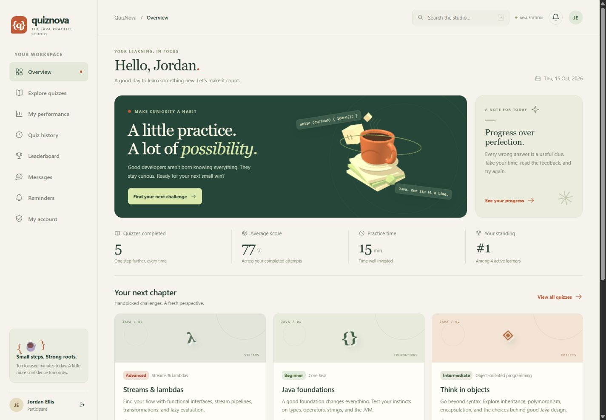

# QuizNova

## Java-Based Online Quiz and Performance Management System

Student name:

Roll number:

Team name:

Review documents: [rubric evidence](docs/REVIEW-1.md), [architecture and database design](docs/ARCHITECTURE.md), [demo and viva](docs/DEMO-AND-VIVA.md), [hosting](docs/DEPLOYMENT.md).

Repository: https://github.com/muskanbuilds11/java-online-quiz-platform

[Review presentation](docs/presentation/QuizNova-Review-1.pptx) · [PDF copy](docs/presentation/QuizNova-Review-1.pdf) · [Automated checks](https://github.com/muskanbuilds11/java-online-quiz-platform/actions)



A complete local Java quiz application with three role-based workspaces, a custom warm ivory / forest green interface, and an interactive WebGL 3D coffee-cup scene. All frontend assets, including Three.js, are served locally.

## Run on Windows

Prerequisites: JDK 17 or newer and Maven 3.6.3 or newer.

Double-click **run.cmd**, or use PowerShell:

```powershell
cd D:\Java-Based-Online-Quiz-Platform
mvn clean verify
java -jar target\quizcraft-1.0.0.jar
```

Open **http://localhost:8080**. Keep the terminal running; press Ctrl+C to stop.

The first Maven build needs internet access to download Java dependencies. After packaging, the JAR runs without Node.js or an internet connection.

## Demo accounts

The first launch seeds a clearly demonstrative workspace: eight quizzes, sample attempts, a conversation, and a reminder. It does not overwrite existing database records.

| Role | Email | Password |
| --- | --- | --- |
| Admin | admin@quizcraft.dev | JavaLab@123 |
| Quiz Creator | creator@quizcraft.dev | JavaLab@123 |
| Participant | participant@quizcraft.dev | JavaLab@123 |

The entry screen opens with **Create your account**. A normal user enters a name, email, password, and matching confirmation. After successful registration, the user signs in with that email and password. Duplicate emails are rejected, and a new account begins with its own empty history. There are no one-click demo sign-ins or embedded demo passwords in the frontend. New registrations always receive the Participant role. The administrator can create additional creators and administrators through User management.

The seeded accounts above are optional sample data and use the normal sign-in form. Change their passwords in My account or User management before sharing the application.

Every role has **My account** for updating a profile name and changing a password after entering the current password. Password changes, administrator password resets, role/email changes, and deactivation revoke existing sessions. Logout invalidates the server session. Accounts, BCrypt password hashes, and quiz activity are persisted in the database; authentication is not a browser-only simulation.

## Implemented workflows

### Administrator

- Create and edit users, assign roles, deactivate/reactivate accounts, and reset passwords.
- Inspect quiz questions, answers, and explanations before approving or returning submitted content with a review note.
- Configure studio name, passing percentage, suggested quiz duration, attempt limits, and maintenance mode.
- View platform performance charts, submission reports, pending-content alerts, and system status.

### Quiz Creator

- Create multiple-choice quizzes with four answer options, a correct answer, an explanation, topic, level, and duration.
- Save drafts, revise rejected content, and submit for administrator approval.
- View quiz history and publication status.
- Review completed attempts, add feedback, and record a reviewed score while preserving the automatic score.
- Send private messages to participants and review topic performance.

### Participant

- Browse and search published quizzes by topic and difficulty.
- Take server-timed quizzes, move between questions, autosave answers, and resume an active attempt.
- Review scores, passing thresholds, answer-by-answer explanations, and reviewer feedback; download a text report.
- View attempt history, performance charts, topic averages, practice time, and leaderboard standing.
- Send private messages to quiz creators.
- Set and remove in-app quiz reminders.

## Timing and grading rules

- A quiz starts only after the participant confirms. The server creates and persists the deadline.
- Refreshing, changing the device clock, or leaving the quiz screen does not extend the server deadline.
- Each selected answer is saved to the server. If a network failure occurs, the screen reports it; keep that tab open and reconnect so unsaved choices can be retried.
- When a deadline passes, a server task submits saved work within approximately 15 seconds. Visiting the attempt or dashboard also settles expired attempts immediately. Late answer changes are ignored.
- MCQs award one point per correct answer, with no negative marking. A creator can add an explained manual score; reports retain both scores.
- Passing thresholds are stored per attempt. Later settings changes do not rewrite historical pass criteria.
- Quizzes with existing attempts cannot be edited or deleted. Create a new quiz version instead.
- The leaderboard sums each learner's best percentage for each distinct quiz. Only active participants are ranked; ties use average percentage and name.

## Local data and configuration

H2 stores data in **data/quizcraft.mv.db**, relative to the directory from which Java starts. Restarting the app preserves accounts, questions, results, messages, and reminders. Back up the data directory with the app stopped.

| Environment variable | Default | Purpose |
| --- | --- | --- |
| PORT | 8080 | HTTP port |
| SERVER_ADDRESS | 127.0.0.1 | Local-only listening address |
| DATABASE_URL | jdbc:h2:file:./data/quizcraft;DB_CLOSE_ON_EXIT=FALSE | H2 JDBC URL |
| DATABASE_USER | sa | Database user |
| DATABASE_PASSWORD | empty | Database password |
| SEED_DEMO | true | Create demo records on a new database |
| DEMO_PASSWORD | JavaLab@123 | Initial demo password; existing accounts are unchanged |

For a clean database, set `SEED_DEMO=false` and supply `ADMIN_NAME`, `ADMIN_EMAIL`, and a private `ADMIN_PASSWORD` of 12 to 72 characters. `AdminBootstrap` creates the initial administrator only when none exists. It never resets an existing administrator password.

## Technical design

- **Java 17 + Spring Boot 3.5.16**: REST endpoints, validation, application lifecycle.
- **Spring Security**: BCrypt passwords, server sessions, CSRF protection, same-site HTTP-only session cookies, restrictive content security policy.
- **Spring JDBC + H2**: relational persistence, prepared statements, transactions, and row locks for attempt creation/submission.
- **HTML, CSS, native JavaScript modules**: responsive workspaces with semantic forms and keyboard-accessible dialogs.
- **Mobile layouts**: collapsible navigation, touch-sized controls, single-column quiz cards, stacked table records, sticky quiz timer, and readable phone-sized forms. The interface was checked at a 390px phone viewport and a 1440px desktop viewport.
- **Three.js 0.186.1**: a locally bundled animated 3D still life, cursor interaction, visibility-aware rendering, reduced-motion support, and a fallback for unavailable WebGL.

```
Browser (HTML / CSS / JavaScript / Three.js)
                 |
       Spring Security + CSRF
                 |
      ApiController / ReportServlet
                 |
          PlatformService
                 |
       JdbcStore / Spring JDBC
                 |
       H2 / PostgreSQL database
```

Source layout:

```
src/main/java/com/quizcraft/
  QuizcraftApplication.java  Application entry
  SecurityConfig.java       Authentication and request security
  ApiController.java        Validated API contracts and errors
  PlatformService.java      Roles, business rules, persistence, quiz timer
  JdbcStore.java            Prepared JDBC access and row mapping
  QuizScore.java            Immutable scoring model
  ScoringPolicy.java        Scoring interface and MCQ implementation
  ReportFormatter.java      Generic report contract and text formatter
  PerformanceReportServlet.java  Authorized report download
  AdminBootstrap.java       Initial private administrator setup
  DemoData.java             First-launch demonstration records
src/main/resources/
  application.properties    Runtime settings
  schema.sql                Relational schema
  static/                   Interface and bundled 3D library
src/test/java/com/quizcraft/
  PlatformIntegrationTest.java
  ReportServletIntegrationTest.java
  QuizScoreTest.java
  AdminBootstrapTest.java
```

## Verification

```powershell
mvn verify
```

The 21 tests cover authentication, role/ownership permissions, publication, scoring, expiry, concurrent starts, manual reviews, messages, reminders, secure admin bootstrap and the native servlet over real HTTP. The platform integration suite also runs against PostgreSQL 17 in GitHub Actions. Both H2 and PostgreSQL jobs have passed.

## Core Java and servlet evidence

- `JdbcStore` centralizes database access, including explicit PreparedStatement parameter binding, generated identities, typed generic queries, and SQL row mapping.
- `ScoringPolicy` defines a scoring contract. `MultipleChoiceScoringPolicy` implements it, and immutable `QuizScore` validates score invariants and calculates exact pass decisions.
- Generic `ReportFormatter<T>` decouples a report from its output format. `TextReportFormatter` implements the text output.
- `PerformanceReportServlet extends HttpServlet` overrides `doGet` at `/reports/attempts/{id}`, reads the principal/request path, and streams an authorized UTF-8 attachment. The UI export button uses this servlet. Spring MVC's DispatcherServlet handles REST separately.
- Collections, streams, scheduling, transactions, and row locks implement data lookup and safe concurrent quiz operations. A concurrent Start test verifies that parallel requests create only one active attempt.

The internal Java package, JAR artifact and local database filename retain `quizcraft` identifiers for compatibility. QuizNova is the submitted product name.

## Cloud deployment

The Dockerfile and `render.yaml` prepare a free Render web service with external PostgreSQL. Set `SPRING_PROFILES_ACTIVE=cloud`, the `DATABASE_*` values, and private `ADMIN_*` credentials. The cloud profile disables demo accounts, uses secure cookies behind HTTPS, and requires PostgreSQL. See the deployment guide for full steps. A local server and a prepared repository do not constitute a live hosted deployment.

## Scope

Reminders and messages are internal to QuizNova; email delivery, push notifications, code execution, essay grading, and password recovery email are not included. The application is configured as a local project. The cloud profile supplies HTTPS-proxy/session settings; actual hosting requires provider accounts and a private persistent database connection.

Three.js is MIT licensed; its license is included under `src/main/resources/static/vendor/THREE-LICENSE.txt`.

Framework reference: [Spring Boot system requirements](https://docs.spring.io/spring-boot/3.5/system-requirements.html).
