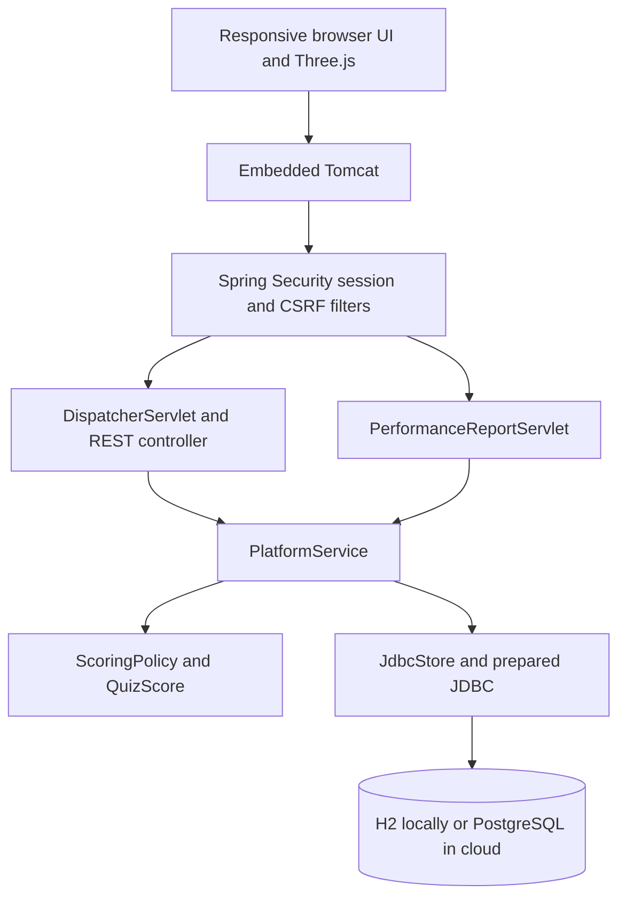
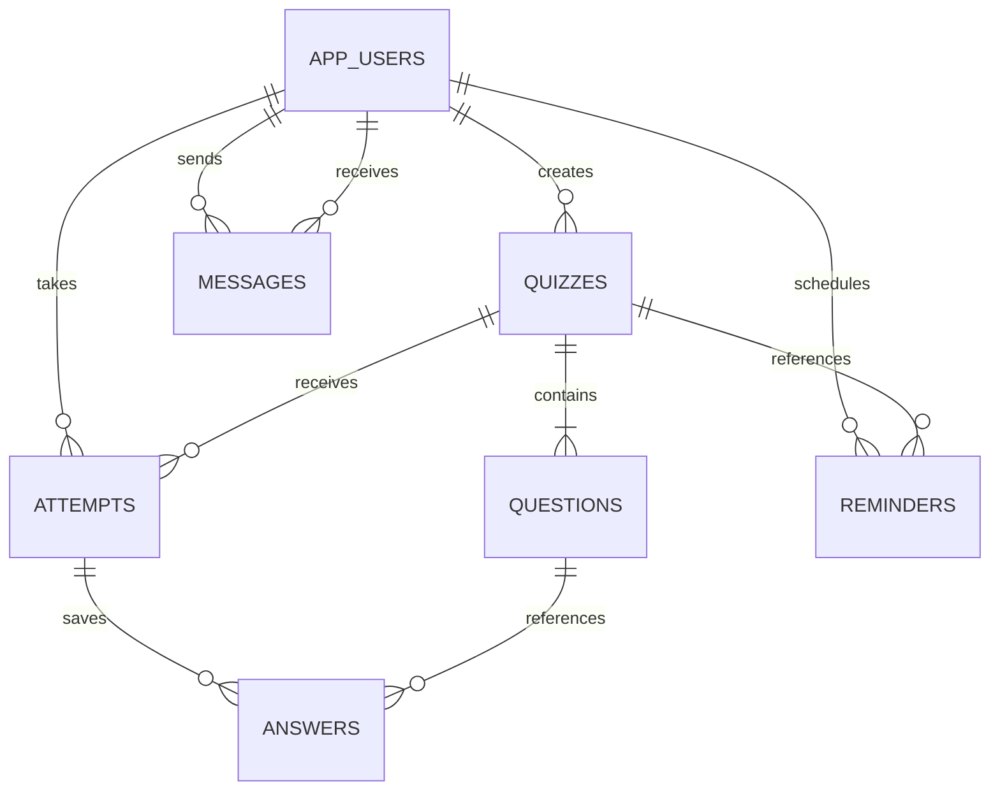

# Architecture and database design

Participants register and take approved quizzes. Creators own quiz content and review results. Administrators manage users, content approval and settings. Server checks protect roles and ownership independently of the visible menus.

## Database relationships

| Table | Key and purpose |
| --- | --- |
| app_users | id PK, email UNIQUE, hashed password, role and active status |
| quizzes | id PK, creator_id FK, duration, difficulty, publication status |
| questions | id PK, quiz_id FK, four options, correct index, explanation |
| attempts | id PK, quiz_id/participant_id FKs, deadline, scores, threshold |
| answers | attempt_id + question_id composite PK/FKs, selected index |
| messages | id PK, sender_id/recipient_id FKs, body and timestamp |
| reminders | id PK, user_id/quiz_id FKs, reminder time |
| system_settings | Single id PK, title, passing score, attempt limits, maintenance |

Foreign keys protect references. Check constraints validate roles, quiz states, answer indices and durations. Indexes support user/quiz history, question loading and message lookup. Separate relations avoid repeating users or quiz content in every result. The passing threshold is intentionally snapshotted per attempt. Fixed columns for four options match the MCQ scope.

## Lifecycle and timing

Quizzes move from DRAFT to PENDING, then APPROVED or REJECTED. Returned content can be revised and resubmitted. Only approved content appears to participants. Quizzes with attempts cannot change, so historical answers keep their meaning.

Starting an attempt stores its server deadline. Each choice saves through an authenticated API. Submission scores stored answers once and reveals explanations. A scheduled job settles expired attempts. Late choices cannot change the result.

HTTP requests and the scheduler can overlap on different threads. Transactions plus `SELECT ... FOR UPDATE` serialize attempt writes. A user-row lock prevents duplicate starts. This works across JVMs sharing a database, whereas a Java `synchronized` block alone does not.

Bean Validation handles malformed inputs. Service rules return controlled status errors for role, ownership and lifecycle violations. Prepared JDBC parameters keep user data separate from SQL syntax.

## Native servlet

Spring MVC serves REST routes through DispatcherServlet. A separate Jakarta `PerformanceReportServlet` serves `GET /reports/attempts/{id}`. It reads the principal and path, asks the same authorized service for a submitted result, and writes a UTF-8 attachment using `ReportFormatter<T>`. Anonymous requests receive 401, other participants receive 403, and unfinished attempts cannot export solutions.
